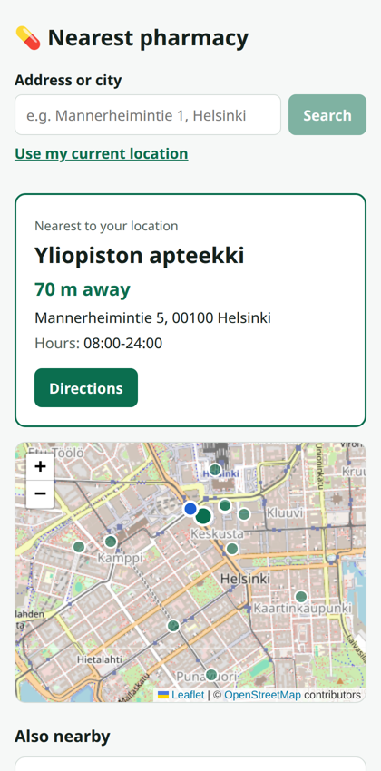
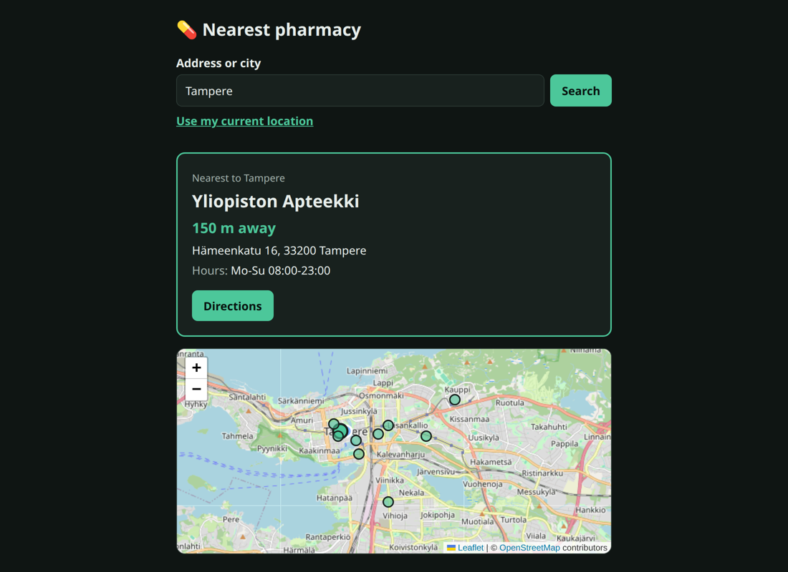

# Nearest Pharmacy (web)

Finds the pharmacy nearest to you and shows it with its distance, address, opening hours and a **Directions** button, plus a map and the next ten nearest.

<p>
  
  
</p>

## Run it

Needs Node 20.19+ (tested on 24). No API keys or config.

```sh
npm install
npm run dev      # http://localhost:5173
npm test         # unit tests (Vitest)
npm run build    # type-check and production build into dist/
```

## How it works

1. Asks for your location with the browser Geolocation API. If you decline, or it fails, the address field takes focus and you can type a street or city instead. That is geocoded with **Nominatim**.
2. Queries **Overpass** (OpenStreetMap) for `amenity=pharmacy` within 3 km. If nothing is there it widens to 10 km, then 30 km. Anything found within radius *r* is guaranteed to be the true nearest, so it only widens when the result is empty.
3. Distances are computed locally with the haversine formula and sorted. The nearest is shown prominently, the next ten in a list, all of them on a Leaflet map with OSM tiles.
4. **Directions** opens Apple Maps on Apple devices and Google Maps elsewhere (which hands off to the app on Android).

| File | What's in it |
| --- | --- |
| `src/geo.ts` | Haversine distance, sorting, distance formatting |
| `src/overpass.ts` | Overpass query, response parsing, radius widening, retries |
| `src/location.ts` | Geolocation and Nominatim geocoding |
| `src/App.tsx` | UI states: locating → loading → results / empty / error |
| `src/PharmacyMap.tsx` | Leaflet map |

## Data sources and their limits

- **OpenStreetMap via Overpass.** Free and keyless, but the public instances are shared and often at capacity. Requests time out after 30 s, fall back to a mirror (`maps.mail.ru`), and retry with exponential backoff (1 s, 2 s) as the instances ask. A search can still take several seconds on a bad day.
- **Coverage** depends on OSM volunteers. Finnish pharmacies are well mapped, but addresses or opening hours are missing for some, and the UI simply leaves those out.
- **Nominatim** allows at most one request per second and forbids autocomplete. Geocoding therefore runs only when you submit the form, and the button is disabled while a search is running.
- **Opening hours** are shown as the raw OSM `opening_hours` string (e.g. `Mo-Fr 08:00-21:00; Sa 10:00-18:00`).

## Trade-offs

- **No map library wrapper.** Leaflet is used directly in one `useEffect`. `react-leaflet` would add a dependency for a single map. Circle markers avoid Leaflet's default icon images, which need bundler workarounds.
- **No state or data-fetching library.** One discriminated-union `State` covers every screen, and an `AbortController` makes sure a slow, stale search never overwrites a newer one.
- **Public Overpass instead of a backend.** It keeps the app keyless and static, at the cost of the latency above.

## What I'd do next

- A small backend or edge function that caches Overpass results per area. This makes searches faster and spares the public instance.
- Parse `opening_hours` (with the `opening_hours` package) to show "Open now · closes 21:00" and optionally prefer open pharmacies.
- Show which list item matches which map marker and highlight on hover/focus.
- Add an end-to-end test (Playwright) with mocked geolocation for the happy path and the denied path.
